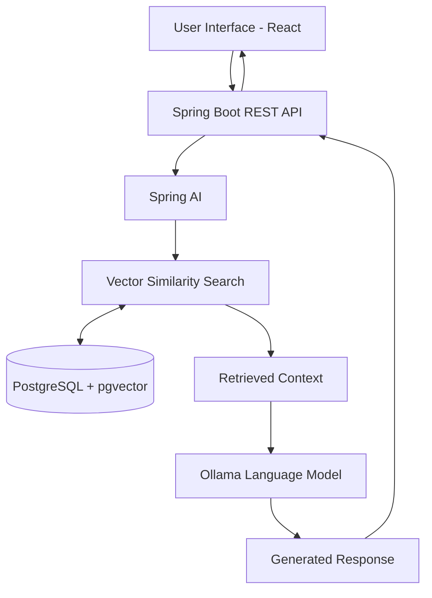

<!-- ==================== HEADER ==================== -->

<div align="center">


<a href="https://github.com/Haniesreb312">
  
</a>

<br/>

[](https://www.linkedin.com/in/hani-esreb-b76b412a4)
[](mailto:haniassreb@hotmail.com)
[](https://github.com/Haniesreb312)


</div>

<!-- ==================== ABOUT ==================== -->

## 👨‍💻 A Little About Me

I'm a Computer Science Engineer currently pursuing my Master's in Data Science at TU Wien, Austria.

I enjoy working at the intersection of software engineering, artificial intelligence and data science — building applications, exploring data and figuring out how technology can solve practical problems.

My background also includes hands-on IT support, full-stack development and working in Agile teams.

```python
class HaniEsreb:

    def __init__(self):
        self.location = "Vienna, Austria"

        self.education = {
            "MSc": "Data Science @ TU Wien",
            "BSc": "Computer Science Engineering",
            "GPA": "4.53 / 5.00"
        }

        self.languages = ["Arabic", "English"]

        self.interests = [
            "Software Engineering",
            "Artificial Intelligence",
            "Data Science",
            "Backend Development"
        ]

        self.open_to_work = True

    def current_mission(self):
        return "Learn. Build. Improve. Repeat."


developer = HaniEsreb()
print(developer.current_mission())
```

<!-- ==================== TECH STACK ==================== -->

## 🛠️ Technical Arsenal

<div align="center">

### Programming Languages

<a href="https://dev.java/">
  
</a>
<a href="https://www.python.org/">
  
</a>
<a href="https://www.r-project.org/">
  
</a>
<a href="https://www.typescriptlang.org/">
  
</a>
<a href="https://developer.mozilla.org/en-US/docs/Web/JavaScript">
  
</a>
<a href="https://www.mathworks.com/products/matlab.html">
  
</a>

### Frontend Development


### Backend Development


### Databases & Infrastructure


### Development Environment


### Data Science & Artificial Intelligence


</div>

<!-- ==================== PROJECTS ==================== -->

## 🚀 Selected Projects

### 🩺 HealthAI — AI-Powered Symptom Checker

A full-stack healthcare research application exploring how artificial intelligence and retrieval-augmented generation can support symptom assessment.


<details>
<summary><b>🔍 Explore the architecture</b></summary>

<br/>



**Technical highlights**

- Retrieval-Augmented Generation architecture
- Local large language model integration
- Vector embeddings and similarity search
- RESTful backend services
- OAuth 2.0 and Keycloak authentication
- Containerized infrastructure with Docker
- Responsive TypeScript frontend

</details>

[📄 Read my bachelor's thesis](https://hdl.handle.net/2437/404358)

> Academic research project — not intended to replace professional medical advice.

---

### 🌍 TerraScope — AI-Powered Country Explorer

An interactive platform combining artificial intelligence and external APIs to provide country profiles, comparisons and real-time information.


<details>
<summary><b>🔍 Explore project features</b></summary>

<br/>

- AI-generated country insights
- Interactive maps
- Economic data visualization
- Real-time weather information
- Currency conversion
- News aggregation
- Multilingual country profiles
- Responsive user interface

</details>

---

### 📈 WealthWise — Financial Planning Platform

A collaborative web application designed to help users manage budgets, investment portfolios and retirement planning.


<details>
<summary><b>🔍 Explore my contributions</b></summary>

<br/>

- Frontend development and UI design
- User stories and requirements definition
- Sprint planning and backlog refinement
- Cross-functional team collaboration
- Sprint reviews and retrospectives
- Iterative development based on feedback

</details>

<div align="center">

[](https://github.com/Haniesreb312?tab=repositories)

</div>

<!-- ==================== EDUCATION ==================== -->

## 🎓 Education & Professional Background

| Institution | Qualification | Period |
|---|---|---|
| 🇦🇹 **TU Wien** | MSc Data Science | 2026 – Present |
| 🇭🇺 **University of Debrecen** | BSc Computer Science Engineering | Graduated 2026 |

**Bachelor's GPA:** 4.53 / 5.00 — Excellent

<details>
<summary><b>🏅 Certifications</b></summary>

<br/>

- IBM — Data Fundamentals
- IBM — Generative AI Essentials: Using LLMs to Work with Data
- IT Specialist — Databases
- IT Specialist — Networking
- IT Specialist — JavaScript
- IT Specialist — HTML and CSS
- IT Specialist — HTML5 Application and Development
- IT Specialist — Device Configuration and Management

</details>

<details>
<summary><b>💼 Professional experience</b></summary>

<br/>

**IT Support Assistant — SYSTEM Ceramic & Marble**

Remote | June 2024 – Present

- Hardware and software troubleshooting
- Company email account management
- Remote employee technical support
- Data organization and daily IT operations

**IT Specialist Intern — CFI Global Talent**

Budapest, Hungary | April 2025 – July 2025

- Employee technical support
- Computer hardware installation and maintenance
- Assistance with data management

</details>

<!-- ==================== CURRENT WORK ==================== -->

## 🔬 Currently Exploring

```yaml
current_focus:
  university: TU Wien
  programme: MSc Data Science

  learning:
    - Statistical Modelling
    - Machine Learning
    - Data Visualization
    - Knowledge Representation
    - Intelligent Systems

  building:
    - Full-stack applications
    - Data analysis projects
    - AI-powered solutions

  career:
    location: Vienna, Austria
    available_for:
      - Working Student Positions
      - Internships
      - Junior Engineering Roles
      - Research Opportunities
```

<!-- ==================== STATISTICS ==================== -->

## 📊 GitHub Analytics

<div align="center">

<picture>
  <source media="(prefers-color-scheme: dark)" srcset="https://github-readme-stats.vercel.app/api?username=Haniesreb312&show_icons=true&theme=tokyonight&hide_border=true&rank_icon=github"/>
  
</picture>
<picture>
  <source media="(prefers-color-scheme: dark)" srcset="https://github-readme-stats.vercel.app/api/top-langs/?username=Haniesreb312&layout=compact&theme=tokyonight&hide_border=true"/>
  
</picture>

<br/><br/>


<details>
<summary><b>📈 Contribution activity</b></summary>

<br/>


</details>

</div>

<!-- ==================== CONTACT ==================== -->

## 🤝 Let's Build Something

I'm currently open to professional opportunities in Vienna, particularly in software engineering, data science, AI and technical operations.

Whether it's a research project, an engineering challenge or an interesting collaboration, I'm always happy to connect.

<div align="center">

[](https://www.linkedin.com/in/hani-esreb-b76b412a4)
[](mailto:haniassreb@hotmail.com)

**English — C1 | Arabic — Native**

<br/>

<sub>Curiosity drives learning. Consistency drives progress.</sub>


</div>
